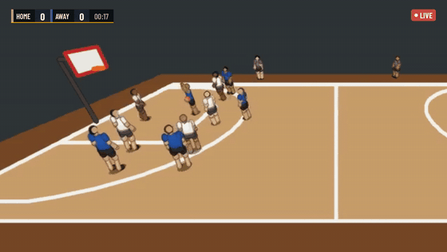
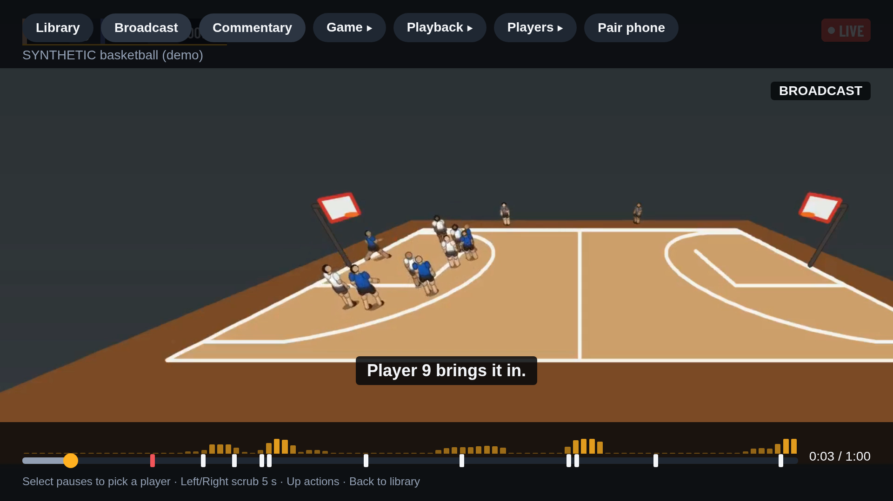
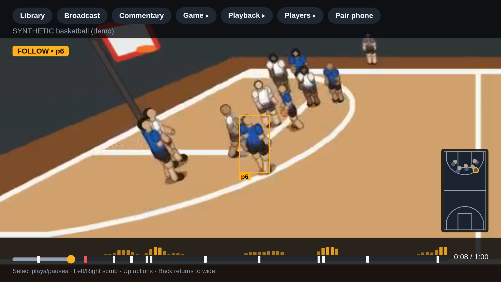
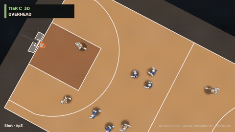
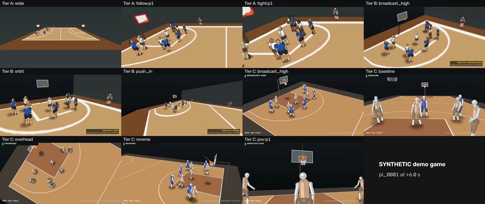
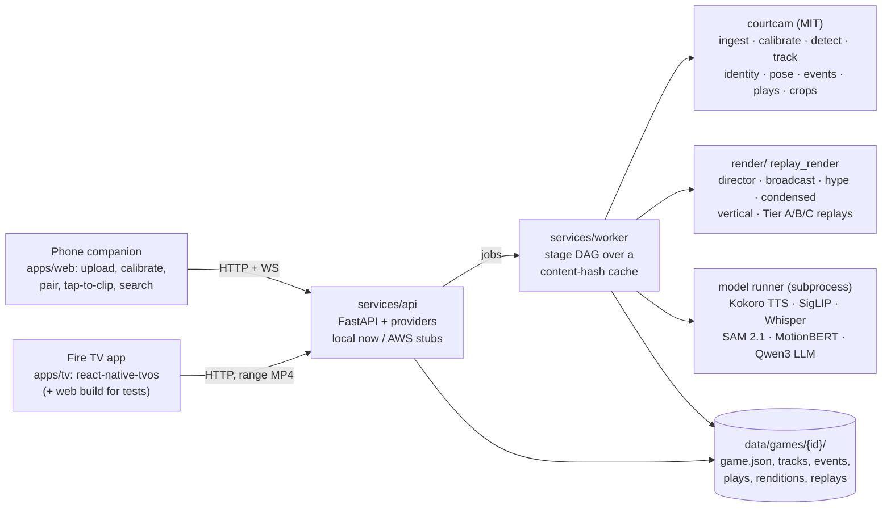

# Replay

**One phone on a tripod in; a directed, graphics-rich, replay-filled game on your Fire TV out.**

Replay turns an amateur recording of a court-sports game (basketball first; pickleball,
badminton and volleyball through sport profiles) into something that watches like a
broadcast: pick any player with the remote and the camera follows them, switch on
broadcast mode for an auto-directed cut with a score bug, instant replays and grounded
play-by-play, say or tap "Replay, clip that" to clip the play that just ended, cut
between virtual replay angles, and browse highlights, rallies, a box score and player
cards — all from the D-pad.

Built for the Amazon Developer Hackathon (Fire TV track; AWS Builder and Open Source
mini challenges). The computer-vision core is [`courtcam/`](courtcam/README.md), an
MIT-licensed library published separately (D-36).

| | |
|---|---|
|  |  |
| The `make demo` broadcast rendition: score bug, sting, 0.5× REPLAY | Broadcast mode on the TV app with commentary captions and the hype meter |
|  |  |
| Follow mode: pick a player, the camera follows; court inset bottom right | Tier C: stylized 3D reconstruction, overhead angle, ball through the rim (outcome set from synthetic truth, M9) |


*One highlight of the `make demo` game at the same instant from all 11 pre-rendered
angles: Tier A (real video: wide, follow, tight), Tier B (2.5D cutouts: broadcast high,
orbit, push-in), Tier C (3D mannequins: broadcast high, baseline, overhead, reverse,
shooter's POV). On the TV, Left/Right cuts between them at the same media time.*

Every image above is **synthetic** (generated mannequins on a rendered court) — see
"Honest limitations".

## Quickstart: `make demo`

All compute runs on a shared ROCm GPU box (`hfbox`, docs/compute.md); the laptop edits,
syncs and views.

```sh
make demo          # sync → build the demo games on the box → serve API + TV app + phone companion
make demo-tunnel   # second terminal: forward the ports here
#   TV     http://localhost:5190/            arrows = D-pad, Enter = select, Esc = back
#   phone  http://localhost:5191/companion   pair with the code the TV shows
make demo-stop
```

`make demo` generates two **synthetic** games with `courtcam synth` (basketball full
court and pickleball doubles, 60 s each, fixed seeds) and runs them through the worker:
ingest → calibrate → detect → track → court → identity → crops → audio → pose → events
→ triggers → plays, then grounded commentary (template text; Kokoro TTS narration if
available, else captions), hype meter, auto-director + broadcast rendition, Tier A/B/C
replays for the top 3 highlights, a 9:16 export, a SigLIP search index (if available),
and the condensed game + rally browser for pickleball. It does not need real footage.
Everything is cached by content hash, so a second `make demo` is all cache hits; times
are in [docs/perf.md](docs/perf.md). The build runs detached on the box (log:
`<copy>/data/demo-build.log`); if your ssh session drops, run `make demo` again. The 3–4 minute walk-through is
[docs/demo-script.md](docs/demo-script.md).

Other entry points: `make test` (every suite on the box, `scripts/box-test.sh`),
`python -m replay_worker run <video>` (services/worker/README.md), `courtcam run`
(courtcam/README.md).

### Developing without the box

```sh
uv sync                                   # workspace venv (courtcam[yolo] + api + worker + render), CPU torch
REPLAY_PIPELINE=fake uv run --package replay-api uvicorn replay_api.main:app --port 8000
cd apps/tv && pnpm install && VITE_MOCK_API=1 pnpm web    # TV app on the in-browser mock API
uv run pytest courtcam/tests services/api/tests services/worker/tests render/tests -q
```

API env vars are in services/api/README.md; the TV/phone apps read `VITE_REPLAY_API_BASE`.

## Architecture



- **TV app** (`apps/tv`, D-37): react-native-tvos 0.87 + react-native-video; pure logic
  shared in `packages/tv-core`; platform code only behind `PlayerSurface` / `platform/`;
  overlays sync to one media clock; every screen reachable with D-pad + Back; never
  branches on the sport (reads the profile's `sport_ui`).
- **API** (`services/api`): FastAPI; ten providers (storage, index, jobs, labeler,
  query, tts, llm, embeddings, face, speaker), each a working local implementation plus an
  AWS stub (D-35). AWS map: [docs/aws-integrations.md](docs/aws-integrations.md).
- **Worker** (`services/worker`, D-34): named, versioned stages with declared inputs and
  outputs, cached by content hash, GPU tasks under a box-wide lock; the local stand-in
  for Step Functions + SageMaker Processing (`infra/dag.json` mirrors it).
- **Contracts**: every JSON file carries `"schema": "replay.<name>.v1"` (D-49, D-56, D-59).

## Feature status

Per-milestone detail, commands and measured numbers: [docs/progress.md](docs/progress.md).
Decisions: [docs/decisions.md](docs/decisions.md).

| feature | status | notes |
|---|---|---|
| Upload, calibration (taps + template auto-fit), full camera K/R/t | works | D-19, D-24, D-53 |
| Detection + tracking + identity | works, weak on small players | YOLO11m + BoT-SORT; synthetic basketball IDF1 0.25–0.31 |
| Watch: wide, select, follow, spotlight, court inset, tagging | works (web build) | M3; APK not run on a device |
| Events, play grammars, score | works on synthetic, partial on real | shots 21/27 at P 1.00 synthetic; real shot recall 3/6 |
| "Replay, clip that": tap / gesture / voice | tap works; gesture + voice on synthetic only | gesture recall 0.41 (ViTPose), voice 37/37 synthetic |
| Broadcast mode (director, graphics, replays, audio) | works | D-42, D-43 |
| Grounded commentary, advice, query | works | template 28/28 grounded; LLM paraphrase optional |
| Tier A / B / C replay angles + TV angle switching | works, approximations labelled | D-54..D-59 |
| Hype meter, condensed game, rally browser, 9:16 export, review queue, box score | works | M11 + TV integration |
| Semantic search | works with SigLIP; keyword fallback | weak on synthetic frames |
| Profiles, cards, cross-game links, opt-in faces | backend works; TV/phone screens in progress | D-58 |
| AWS (S3, DynamoDB, Step Functions, Bedrock, Polly, Rekognition) | stubs + CDK skeleton only | nothing calls AWS |
| Tier D (Gaussian splats, generative views) | experiments only | experiments/, docs/tier-d.md |

## Honest limitations

- **The demo and all committed media are synthetic.** Real-footage runs happened only
  on YouTube-licensed local clips (never committed, D-7) and a few Creative-Commons
  clips (docs/test-data.md). Accuracy on real rec-league video is below the synthetic
  numbers: tracking fragments small far players, real shot recall is low, gesture
  recall is 0.41 and voice triggers are untested on real game audio.
- **No device testing.** The Fire TV APK builds but has never run on a Fire TV or an
  emulator; playback, key codes and performance on Fire OS are unverified.
- **Tier B/C are honest approximations**, labelled on every frame: flat cutouts,
  plate ghosts, flattened jumps, monocular depth, stylized mannequins (no body model).
- **Shot outcome** in replays and stats is "unknown" until a user answers the review
  question; net-sport auto score needs a detected point winner.
- **Local only.** No AWS deployment; providers fall back to local models on one box.

## Licences

- Replay's own code: see each package. `courtcam/` is **MIT**; its core depends only on
  permissive packages. The YOLO backend is the optional `courtcam[yolo]` extra
  (ultralytics, **AGPL-3.0**); the replay app installs it by default, so a distributed
  build of the whole app carries the AGPL unless the detector is swapped.
- Models: Kokoro-82M, SAM 2.1, SigLIP, Whisper, ViTPose, YuNet/SFace are permissive;
  MotionBERT (Apache-2.0 weights trained on academic-only Human3.6M) and the face/voice
  models are opt-in and replay-side only; no SMPL, no InsightFace, no non-commercial
  wake-word models. Full table: [docs/licenses.md](docs/licenses.md).
- Font: Barlow Condensed (SIL OFL 1.1). Footage: synthetic (ours) or CC BY 3.0 with
  attribution in docs/test-data.md.

## Repo layout

```
courtcam/        MIT CV library + CLI (synth, run, calibrate, eval, overlay, render)
services/api/    FastAPI backend + providers (local / AWS stubs)
services/worker/ stage DAG + content-hash cache; `python -m replay_worker run|status|perf|dag`
render/          replay_render: director, broadcast compositor, hype, condensed, vertical, Tier A/B/C
apps/tv/         Fire TV app (react-native-tvos) + its web build
apps/web/        phone companion + uploader (+ the original browser TV harness)
packages/tv-core shared TV logic (API client, spatial focus, media clock, follow math)
infra/           AWS CDK skeleton (never deployed)
samples/         synthetic/ (generator outputs + goldens); real/ is local-only, gitignored
scripts/         box-test.sh, box-demo.sh, split-courtcam.sh, eval tools
docs/            decisions, progress, perf, compute, licenses, test-data, demo-script,
                 friction-log, aws-integrations, evidence/<milestone>/
```

Docs worth reading next: [docs/compute.md](docs/compute.md) (the box and its rules),
[docs/friction-log.md](docs/friction-log.md), [docs/evidence/README.md](docs/evidence/README.md).
