# Replay

[](LICENSE)

Replay is open source under the [MIT License](LICENSE).

Film a pickup court game with one phone on a tripod, upload it from the phone, and watch it on Fire TV like a broadcast.

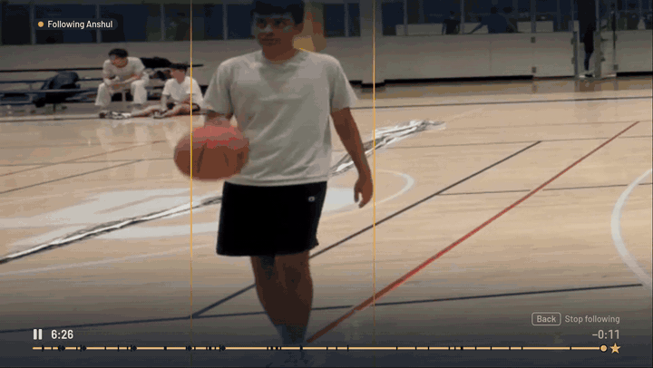

Replay is our entry in the Amazon Developer Hackathon (Fire TV track). The phone uploads the full game straight to S3. A GPU worker on Amazon EC2 turns it into tracked players, plays, highlights, replay angles and commentary. The Fire TV app, driven entirely by the D-pad, plays it back.

The computer-vision core is [courtcam](https://github.com/subatomic-hamster/courtcam), an MIT-licensed library published as its own repository (also vendored here in `courtcam/`).

## On the TV

Native React Native for TV (`react-native-tvos` 0.87 and `react-native-video`) on a Fire TV Stick. Every screen is reachable with the D-pad and Back.

|                                                                                                       |                                                                                                           |
| ----------------------------------------------------------------------------------------------------- | --------------------------------------------------------------------------------------------------------- |
| 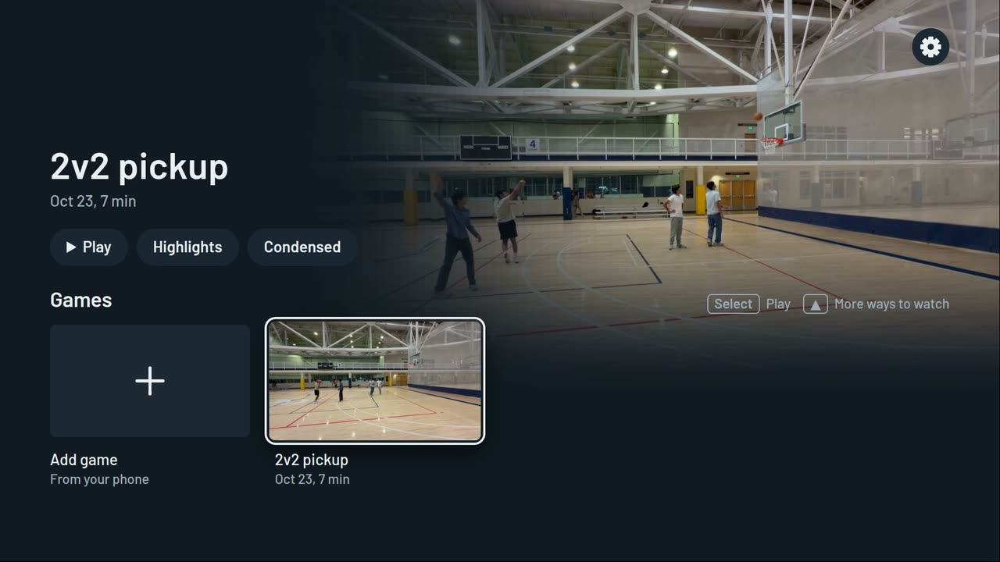                                                                       | 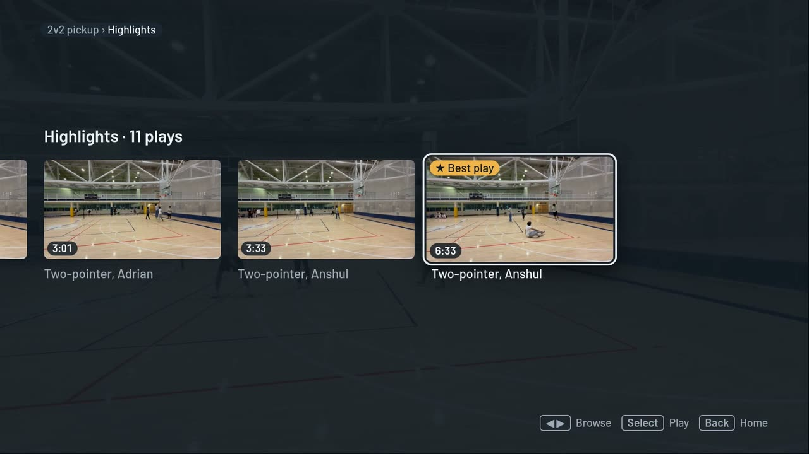                                                          |
| **Home.** The game with Play, Highlights and Condensed.                                               | **Highlights.** Every play as a card, with the ★ Best play card last, and Play all.                       |
| 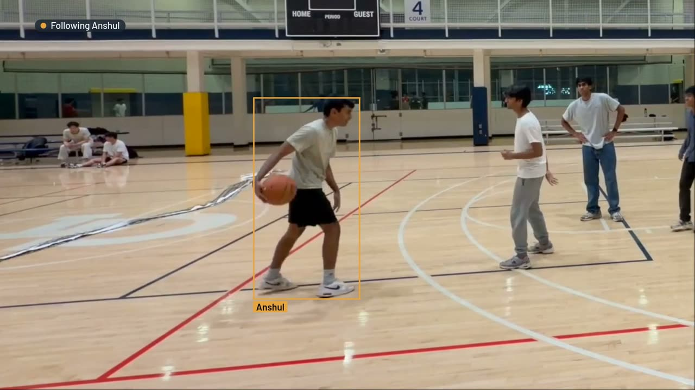                                                         | 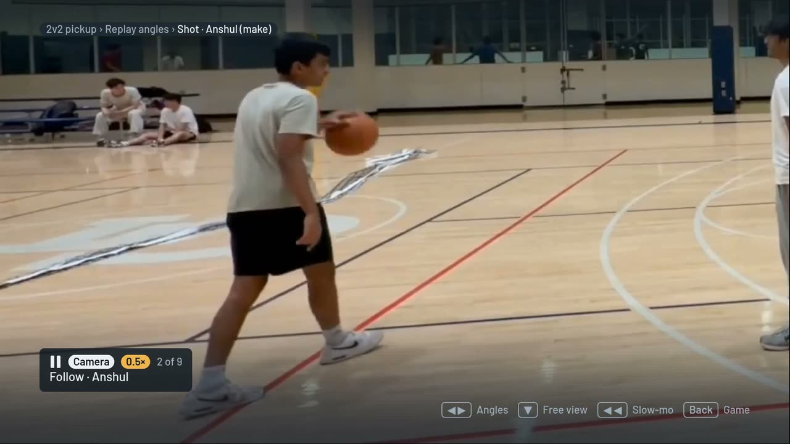                                          |
| **Follow a player.** Pick a player and the camera follows them ("Following Anshul").                  | **Replay angles.** Real camera angles and virtual ones, with 0.5× slow motion on the remote's Rewind key. |
| 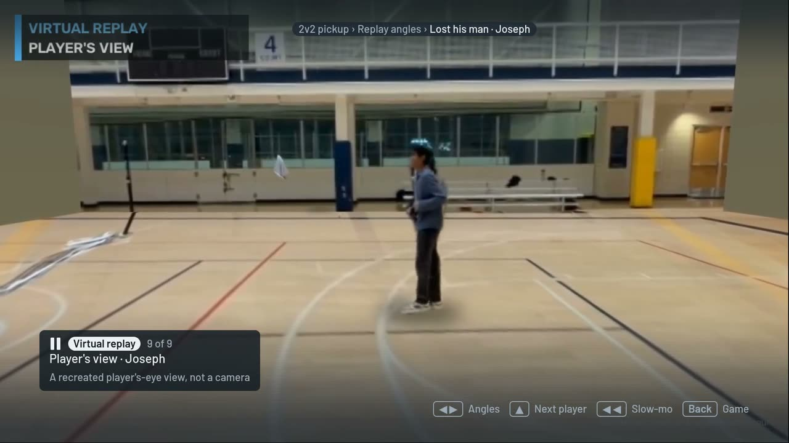                                                               | 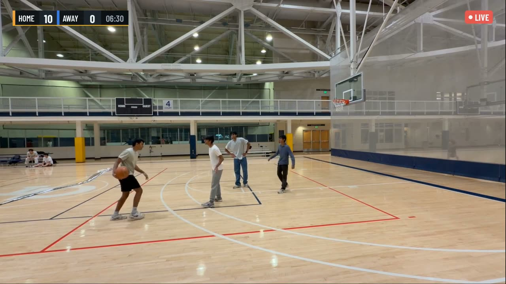                                                          |
| **Player's view.** A recreated player's-eye view, one of the virtual replay angles (alongside Orbit). | **Commentary mode.** A broadcast rendition with a score bug, captions and spoken play-by-play.            |
| 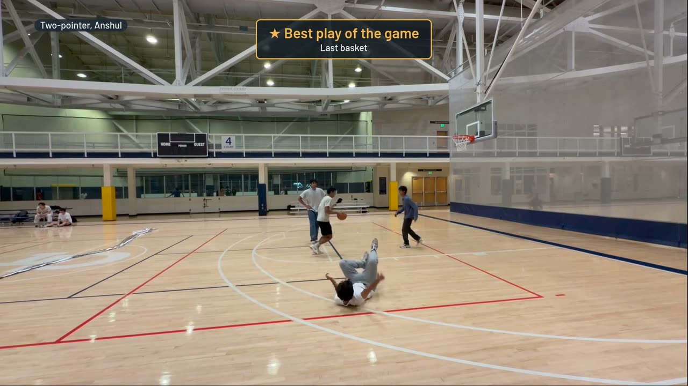                                                       | 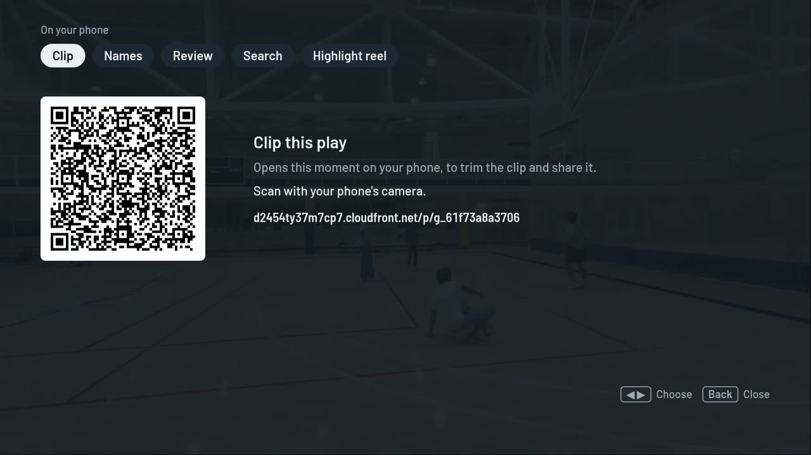                                                        |
| **Best play.** The highlights end on the best play of the game, labelled Last basket.                 | **On your phone.** QR codes for Clip this play, Names, Review, Search and the Highlight reel.             |

Also on the TV:

- A Moments browser for jumping to plays, such as "Lost his man, Joseph".
- A condensed version of the game.
- Voice clips: say "Replay, clip that" and Whisper picks it up.
- Spoken play-by-play from Kokoro TTS, fed into the broadcast stage.
- Alexa: "Alexa, ask Replay Court to clip that" or "... to export a highlight reel". The custom skill (`alexa/skill-package/`) calls the Lambda API at `/alexa`, which verifies the signed request and queues the command, and the TV shows the clip or reel. Pairing links an Echo or the Fire TV remote's mic to the TV.

## On the phone

A React and Vite web app served by CloudFront. Scan a QR code from the TV and it opens.

|                                                                                 |                                                                                               |                                                                       |
| ------------------------------------------------------------------------------- | --------------------------------------------------------------------------------------------- | --------------------------------------------------------------------- |
| 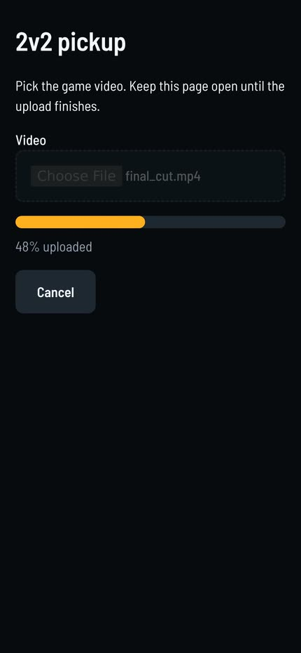                                 | 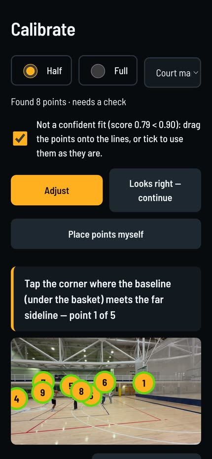                                              | 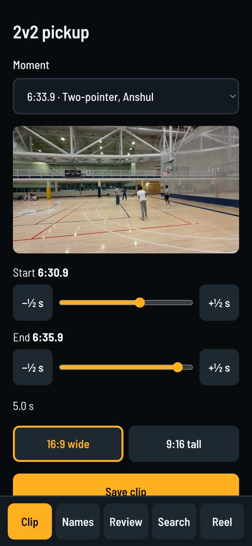                            |
| **Upload.** The full game goes straight to S3 with presigned multipart uploads. | **Calibrate.** Auto court fit, then a tap-to-check. Processing starts with a live stage list. | **Share.** Open a clip from the TV QR, trim it, save it and share it. |

## Architecture

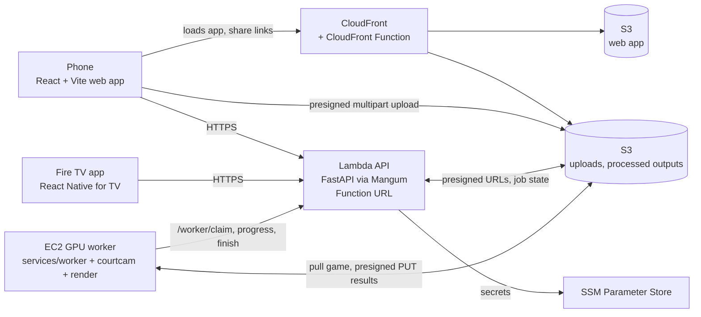

- **Lambda API.** Python 3.12, FastAPI behind Mangum, exposed through a Lambda Function URL. It hands out presigned URLs, tracks jobs and serves game data.
- **S3.** Holds uploads, processed outputs and the web app.
- **CloudFront.** Serves the phone app and share links, with a CloudFront Function at the edge.
- **EC2 GPU worker.** Does the heavy processing. It claims a job from the API (`/worker/claim`), pulls the game from S3, reports progress per stage, uploads results with presigned PUTs, then finishes the job. Moving processing to EC2 GPU instances made it significantly faster.
- **SSM Parameter Store** keeps the secrets. IAM roles are least-privilege and logs go to CloudWatch Logs.
- **AWS CDK (TypeScript).** The stack is `ReplayCloud` in `infra/lib/cloud-stack.ts`.

The worker protocol is documented at the top of `services/api/replay_api/cloud_routes.py`.

## Vision and ML pipeline

The worker runs a cached stage pipeline:

- YOLO11 detection and ByteTrack tracking.
- Court calibration to metres.
- Identity and teams.
- Follow-cam crop paths.
- Pose.
- Events and plays: shots, makes, steals and "Lost his man".
- SAM 2 cutouts for Player's view and the virtual angles.
- Whisper for voice clips and Kokoro for speech.
- FFmpeg rendering.

Sport-specific behavior lives in sport profiles, and core code never branches on the sport.

## Repo layout

```
apps/tv/          Fire TV app (react-native-tvos) and its web build
apps/web/         phone web app: upload, calibration, clip and share
services/api/     FastAPI backend (runs on Lambda)
services/worker/  stage pipeline, runs on EC2 GPU instances
render/           replay_render: director, broadcast, condensed, replay angles
courtcam/         MIT computer-vision library and CLI
packages/tv-core  shared TV logic (API client, focus, media clock, follow math)
infra/            AWS CDK app (ReplayCloud stack)
alexa/            Alexa skill package
scripts/          eval tools and smoke tests
docs/             decisions, deploy runbook, licenses, evidence
```

## Local development

```sh
uv sync                                   # workspace venv (courtcam[yolo] + api + worker + render)
REPLAY_PIPELINE=fake uv run --package replay-api uvicorn replay_api.main:app --port 8000
cd apps/tv && pnpm install && VITE_MOCK_API=1 pnpm web    # TV app on the in-browser mock API
uv run pytest courtcam/tests services/api/tests services/worker/tests render/tests -q
```

API environment variables are in `services/api/README.md`. The TV and phone apps read `VITE_REPLAY_API_BASE`.

## Tests

- pytest suites for `courtcam`, `services/api`, `services/worker` and `render` (the command above).
- Playwright end-to-end tests for the TV app (`cd apps/tv && pnpm e2e`) and the web app (`apps/web`).
- CI runs on GitHub Actions: `.github/workflows/ci.yml`.

## Deploy

Build the API Lambda bundle and the web apps with `infra/scripts/build-api-lambda.sh` and `infra/scripts/build-web.sh`. Create the three SSM SecureString secrets, then deploy with your AWS profile and region set in the environment:

```sh
export AWS_PROFILE=<your-profile> AWS_REGION=us-east-1
cd infra && npm ci
npx cdk deploy ReplayCloud --outputs-file build/outputs.json
```

The full runbook, including bootstrap, secrets and outputs, is in [docs/aws-deploy.md](docs/aws-deploy.md).

## Documentation

- [docs/aws-deploy.md](docs/aws-deploy.md): deploy runbook for `ReplayCloud`
- [docs/decisions.md](docs/decisions.md): design decisions
- [docs/progress.md](docs/progress.md): per-milestone detail
- [docs/licenses.md](docs/licenses.md): model and dependency licenses
- [docs/alexa.md](docs/alexa.md): the Alexa skill and how it reaches the TV
- [devpost_submission/](devpost_submission/): feature requests and the friction log from the build

## License

Replay is released under the [MIT License](LICENSE), and so is `courtcam/`. Third-party models and dependencies keep their own licenses, listed in [docs/licenses.md](docs/licenses.md).
