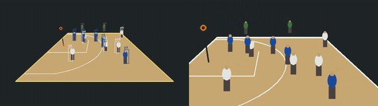

# courtcam



Debug overlay (boxes, ids, court polygon) next to a player follow-cam rendition, on the synthetic CI fixture.

A video pipeline that turns one fixed wide shot of a court into **per-player tracks,
follow-cam crop paths, and events** — so a TV app can let you pick a player out of
the frame and watch the game follow them.

Point a phone at a rec game from the bleachers, click four court corners, and
`courtcam` gives you: every player's position in **metres on the court**, a smooth
follow-cam rectangle per player per frame, and a list of shots. Everything
sport-specific lives in a **sport profile** (a YAML file plus a court template);
core code never branches on the sport.

Part of the [Replay](../README.md) project. MIT licensed.

## Why it is shaped this way

- **A homography, not a 3D reconstruction.** One camera, one flat court. Four clicks
  give you pixels → metres, which is all the on-court filter, the court inset and the
  shot heuristic need.
- **The on-court filter is the whole trick.** A person detector finds the bench, the
  spectators and the guy walking his dog. Projecting each box's foot point onto the
  court and keeping only tracklets that live inside the lines is what makes
  "tap a player" usable.
- **Crop paths, not rendered video.** A crop rectangle per frame is a few KB; the
  client applies it with a CSS transform. Rendering per-player MP4s is the fallback
  (`courtcam render`), done lazily.
- **Stages are pure file → file functions.** Each one skips itself if its output is
  already on disk, so a crashed detect run resumes instead of restarting.

## Install

Python 3.12. From the Replay workspace root:

```sh
uv sync --all-packages --all-extras     # shared .venv with courtcam + services/api
uv run courtcam --help
```

Standalone:

```sh
uv pip install -e "courtcam[dev]"
```

Needs `ffmpeg` and `ffprobe` on `PATH`. The H.264 encoder is picked at run time
(`libx264`, else `libopenh264`, else `h264_qsv`) — not every distro ships libx264.

## CLI

```sh
# 1. make a synthetic court clip + ground truth + landmark clicks (no model needed)
uv run courtcam synth --out samples/synthetic/basketball_half

# 2. run the whole pipeline
uv run courtcam run \
    --input samples/synthetic/basketball_half/clip.mp4 \
    --calib samples/synthetic/basketball_half/landmarks.json \
    --sport basketball --variant half \
    --out out/

# ... with ground-truth boxes instead of YOLO (CI, no weights required)
uv run courtcam run --detector synthetic --input ... --out out/

# only re-run some stages (this also forces them to recompute)
uv run courtcam run --input ... --out out/ --stages detect,track,court

# 3. check it with your eyes: court polygon + boxes + ids burned into an MP4
uv run courtcam overlay --out out/

# other commands
uv run courtcam calibrate --landmarks landmarks.json --out out/calib.json
uv run courtcam render --out out/ --player p1      # rendition-mode follow-cam MP4
uv run courtcam sports                              # installed profiles
```

Useful flags on `run`: `--stride` (detect every Nth frame; the profile's default is 2
= 15 Hz), `--max-frames`, `--title`, `--ground-truth`, `--landmarks` (inline JSON as
well as a path), `--backend {pt,openvino,onnx}` (see "Detection speed").

`courtcam render` writes `media/<player_id>.mp4` and points
`renditions.players[<player_id>]` at it, setting `stages.render` to `partial` — that
is the lazy render the API triggers on first request (D-6).

`--landmarks` / `--calib` accept any of: a `landmarks.json`
(`{"variant": "half", "landmarks_px": {...}}`), a bare `{"corner_nl": [x, y], ...}`
object, or an already-computed `calib.json`.

## Output layout

```
out/
  game.json              replay.game.v1   — the index; `stages` fills in as they finish
  calib.json             homography, its inverse, court polygon in px and metres
  media/wide.mp4         30 fps H.264 faststart mezzanine at source resolution
  media/thumb.jpg  media/calib.jpg
  tracks/00000.json …    replay.tracks.v1 — 10 s chunks at 10 Hz
  crops/p1.json …        replay.crops.v1  — one rect per video frame at 30 Hz, t0 = 0
  events.json            replay.events.v1
  _work/                 intermediates (dets, tracklets, court tracks, players)
```

`_work/` is what makes stages resumable. Delete a file in it to force that stage to
recompute; delete the directory to start over from the mezzanine.

## Stages

| Stage | Reads | Writes |
|---|---|---|
| `ingest` | source video | `media/wide.mp4`, stills |
| `calibrate` | landmark clicks + court template | `calib.json` |
| `detect` | `wide.mp4` | `_work/dets.json` (boxes + track ids) |
| `track` | `_work/dets.json` | `_work/tracklets.json` |
| `court` | tracklets + `calib.json` | `_work/court.json` (on-court only) |
| `identity` | court tracks + `wide.mp4` | `_work/players.json` (`p1..pN`, teams) |
| `tracks` | players | `tracks/*.json` |
| `crops` | players | `crops/*.json` |
| `events` | players + `wide.mp4` | `events.json` |

Detection and ByteTrack association happen in the same Ultralytics pass, so `detect`
emits track ids and `track` only has to group them into tracklets.

## Using it from Python

```python
from pathlib import Path
from courtcam import pipeline

def on_progress(stage: str, fraction: float) -> None:
    print(f"{stage} {fraction:.0%}")

game_json = pipeline.run(
    Path("game.mp4"), Path("out/"),
    sport="basketball", variant="half",
    landmarks_px={"corner_nl": (120, 810), ...},   # or calib=Path("landmarks.json")
    detector="yolo",                                # or "synthetic" + ground_truth=
    progress=on_progress,
    show_progress=False,                            # no tqdm bars in a worker
)
```

`pipeline.run` returns the path to `out/game.json`. Every stage is also importable on
its own (`pipeline.stage_detect`, `stage_crops`, …) if you want to drive them yourself.

## Profile format

A profile is `courtcam/sports/<id>.yaml` plus one court template JSON per variant.
Core code reads only these fields (plan §4.9):

```yaml
id: basketball
display_name: Basketball
tier: 2
court:
  templates: {half: basketball_half.json, full: basketball_full.json}
  variants: [half, full]
  landmarks: [corner_nl, corner_nr, corner_fl, corner_fr, rim]
  landmarks_optional: [key_nl, ...]  # folded into the fit if present; uploader never asks
  margin_m: 1.0                 # how far off the lines a player may stray
players: {min: 2, max: 10}      # caps *merged* players, in `identity` (see below)
team_rule: jersey_color         # or net_side
detection: {classes: [person], stride: 2, model: yolo11n.pt, imgsz: 960, conf: 0.25}
tracking:
  oncourt_min_fraction: 0.6     # of its lifetime a tracklet must spend on court
  min_lifetime_s: 1.0
  merge_max_gap_s: 5.0          # tracklet merge window
  merge_max_dist_m: 7.0
  max_candidates: 400           # guard on the O(n^2) merge, not a roster cap
  smooth_window: 5
events: [shot]                  # which detectors run
shot: {rim_radius_m: 7.0, roi_px: 96, min_gap_s: 2.0, burst_sigma: 2.5, pre_s: 3.0, post_s: 2.0}
followcam: {zoom: 2.4, lead_s: 0.3, stiffness: 7.0}   # zoom divides the COURT's px width
query_vocab: {...}              # read by the API's query engine
sport_ui: {...}                 # read by the TV app; courtcam only carries it
```

A **court template** is metres in the profile's origin convention — baseline centre
under the basket for half-court, centre of one baseline for full-court, `+x` toward
the right sideline, `+y` into the court:

```json
{"name": "basketball_half", "standard": "fiba", "units": "m",
 "size": [15.0, 14.0],
 "court": [[-7.5, 0], [7.5, 0], [7.5, 14], [-7.5, 14]],
 "rim": [0.0, 1.575], "rims": [[0.0, 1.575]],
 "landmarks": {"corner_nl": [-7.5, 0], "...": []},
 "features": {"paint": [...], "three_point": [...], "centre_line": [...]}}
```

`landmarks` are what the uploader asks a user to click; `landmarks_optional` are extra
named points (key corners, free-throw line ends, centre-line ends) that a
`landmarks.json` *may* carry when a corner is off-frame or occluded, as real footage
routinely is. Both are fed to the homography fit. Adding one never changes what the API
requires.

`players.max` is applied in `identity.identify()`, to *merged* players — not in
`court.on_court()`. Real footage breaks one player into a dozen tracklets, so capping
before the merge keeps whoever happened to get the longest unbroken track and throws the
rest of the roster away.

`court` is the polygon the on-court filter tests against. `features` are polylines
for drawing only — the three-point arc is approximated as a 53-point polyline.

## Detection speed

Measured on 100 sampled frames of a 2560×960 whole-court clip, 16-core CPU, no GPU
(`samples/real/RESULTS.md` has the full write-up):

| model | imgsz | backend | sampled fps | boxes/frame |
|---|---|---|---|---|
| yolo11n | 640 | pt | 10.73 | 9.14 |
| **yolo11n** | **960** | **pt** | **5.96** | **13.54** |
| yolo11s | 640 | pt | 5.10 | 12.73 |
| yolo11n | 640/960 | openvino, onnx | slower than pt | same |

Defaults are the bold row. 640 is 1.8× faster and loses 32 % of the boxes — on a wide
shot those are the far-half players, which is exactly the roster. `yolo11s` at 640 is
slower than `yolo11n` at 960 *and* finds fewer boxes.

`--backend openvino|onnx` exports once into `~/.cache/courtcam/`
(`$COURTCAM_CACHE` overrides) keyed by model **and imgsz**, because the export bakes the
input size in, and warns + falls back to the `.pt` model if the export or import fails.
Both lost to plain PyTorch here; measure before switching on another box.

## Adding a sport

1. Write `courtcam/sports/<sport>.json` — the court polygon and line polylines in
   metres, plus `landmarks` for the points a user will click.
2. Write `courtcam/sports/<sport>.yaml` with the fields above.
3. Check it: `uv run courtcam synth --out /tmp/<sport> --sport <sport>` renders the
   template through a camera, then run the pipeline on it with `--detector synthetic`.
   `synth` is fully profile-driven: the camera auto-frames the template, spectators are
   placed just outside `court.margin_m`, and a template with no `rim` gets no shot
   choreography. `courtcam/tests/test_net_sports.py` is that check as a test.
4. If the sport needs a new event type, add a detector function to
   `events.DETECTORS`. Do not add a branch on the sport id anywhere else.

### Team rules

`jersey_color` (basketball, futsal) is k-means over per-tracklet HSV torso histograms.

`net_side` (pickleball, badminton, and any other net sport) is the side of the net the
player's **median court y** falls on, re-evaluated in fixed `identity.NET_WINDOW_S`
(60 s) windows and majority-voted, so an end change between games is picked up coarsely.
The net line comes from the template's `net_y`, or the court's mid-y if it is absent —
which is the geometry of every net sport. Because the split needs the *variant's*
template, `identity.identify()` and `pipeline.stage_identity()` take the variant.

A net sport has no jersey signal (four people, four shirts), so its profile fixes the
two team colours in `teams.colors` and `identity` never decodes the clip for torso
crops at all.

The plan wants the side re-evaluated **per rally**; `events.detect_rallies` is still a
stub, so the fixed window stands in — see the `# ponytail:` note on `identity.net_side`.

### Installed profiles

| profile | variants | tier | team rule | court (m) | notes |
|---|---|---|---|---|---|
| `basketball` | half, full | 2 | jersey_color | 15 × 14 / 15 × 28 | shot events |
| `pickleball` | doubles | 1 | net_side | 6.10 × 13.41 | kitchen 2.13 m from the net |
| `badminton` | doubles, singles | 1 | net_side | 6.10 × 13.40 / 5.18 × 13.40 | short service line 1.98 m from the net |

`/sports` serves these ordered by tier (highest first), because the uploader's picker
defaults to the first entry.

## Tests

```sh
uv run pytest courtcam/tests -q     # ~15 s; no model weights needed
uv run ruff check courtcam/
```

The suite regenerates the synthetic clip if `samples/synthetic/basketball_half/` is
missing, runs the whole pipeline over it with `--detector synthetic`, validates every
output against the schemas, and compares against
`samples/synthetic/basketball_half/golden.json` with tolerances (court positions
±0.25 m, event count ±3).

## Schema notes (deviations from REPLAY_PLAN.md §4.5)

- **`Event.made` is nullable.** The plan shows `"made": true`. The default
  `HeuristicLabeler` cannot see the ball, so it emits `made: null` = unknown. A VLM
  labeler plugged into the `Labeler` protocol fills it in. Clients must treat
  `null` as "not judged yet", distinct from `false`.
- **`court.templates` in a profile.** The plan shows a single `template:`; basketball
  needs a different template per variant, so the loader also accepts
  `templates: {variant: file}`. `template:` still works for single-variant sports.
- No other field names differ. `schema` strings are unchanged.

## Known ceilings

Marked in the source with `# ponytail:` comments.

- **Shot detection is a frame-difference heuristic.** Mean absolute difference in the
  rim ROI fires on any motion there, so a defender under the basket scores like a
  shot. `shot.burst_sigma` is the knob; the real fix is the `Labeler` seam (send the
  candidate clip to a VLM) rather than a better pixel heuristic.
- **The rally detector is a stub** returning `[]`. Basketball does not emit rallies.
- **Ingest always encodes in software.** VAAPI is roughly a 3× win on long files.
- **A single homography, no lens model.** Wide/panoramic gym cameras are barrel
  distorted, so the fit contains the play area but does not sit on the lines. Fine for
  the on-court filter, not for court-metre analytics. `cv2.calibrateCamera` with
  `k1,k2` is the fix — see `samples/real/RESULTS.md`.
- **One follow-cam window per clip.** `followcam.zoom` now divides the court's pixel
  width rather than the frame's, so the same number frames the same way on any source
  (and the window is 16:9 whatever the source aspect is). It is still *one* size for the
  whole clip: on a wide camera a player near the lens is three times the pixel height of
  one at the far baseline, and only a per-player window sized from that player's own box
  would frame both well.


## Real-footage notes

`samples/real/RESULTS.md` (in the Replay repo, not this package) has the full tuning run.
Two things that bite on any wide gym camera and are worth knowing before you click:

- **Skip a landmark you cannot see.** `homography()` needs 4 points the template knows,
  from `landmarks` or `landmarks_optional` — not a specific four. Guessing at an
  off-frame corner is far worse than omitting it: on the Kennesaw clip a plausible
  on-frame guess for `corner_fr` costs 17-21 px of reprojection error, and ~2000 px once
  the optional key/free-throw/centre points are in the fit, versus 0.26 px without it.
- **The reprojection gate scales.** `calibrate()` rejects above `max(5 px, 1 % of the
  clicked landmarks' pixel span)`. A flat 5 px is unreachable by hand on a 2560-px
  panorama, where the image is barrel distorted and one tap is worth several source
  pixels — ±0.5 px of click jitter already moves the error by ~3.5 px.
